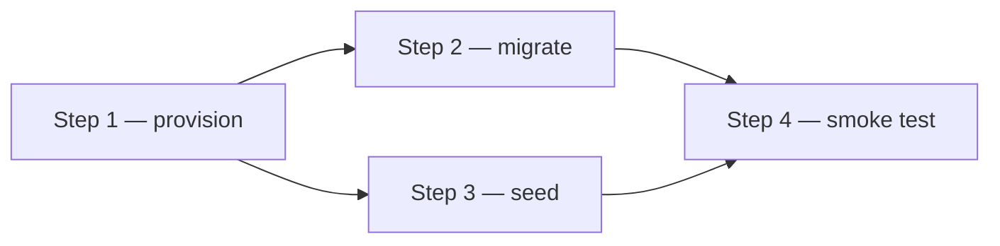

# {{PAGE_TITLE}}

Ordered, re-runnable procedure: fill the Parameters once for the new deployment, then read top to bottom; gotchas sit beside the step that hit them. Updated {{TODAY}}.

## Parameters

Every step references these placeholders. "Current run" records the values used last time.

- `{{PARAM_1}}` — what it is. Current run: `example-value`.

<!-- Optional, only when the step graph is more than a straight chain:
## Dependency map


-->

## Steps

<!-- Step format:
### Step 1 — Generate a GitHub token for repo access

Status: done · Depends on: nothing

What the step does and why, referencing parameters as `{{PARAM_1}}`. Working directory: `/home/{{STACK_USER}}`.

```bash
some-command --flag {{PARAM_1}}
```

> **Gotcha — short headline.** What goes wrong, how to recognise it, and the fix, readable without the conversation history.
-->
